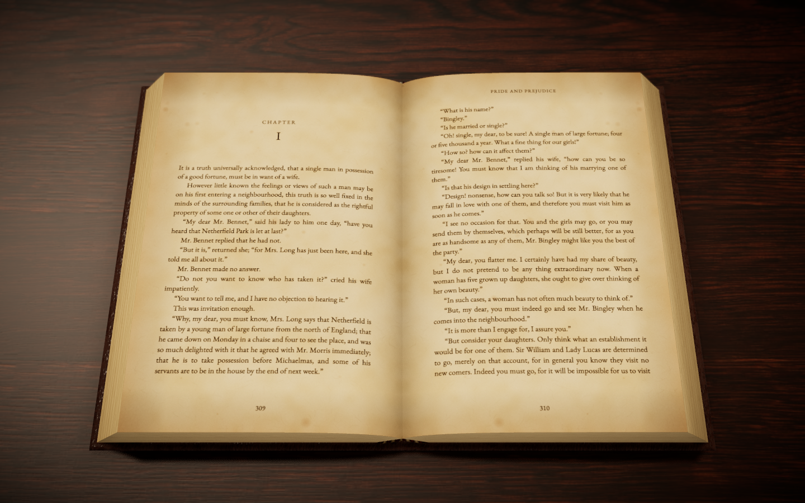

# Bookmoth

A web e-book reader that makes reading feel like holding a book. Bring your own EPUB, PDF, DOCX or TXT file and read it as clean pages, as a photorealistic 3D book on a desk, or as a newspaper.

Everything runs in the browser. There is no server and no account, and books never leave the device: the library, reading positions and settings are kept in IndexedDB.



## Run it

Requires Node 20 or newer.

```sh
npm install
npm run dev        # http://localhost:5173
```

```sh
npm run build      # type-check and build into dist/
npm run preview    # serve the built app
npm run lint
```

The textures and the lighting environment are already in `public/assets`. To fetch them again from Poly Haven (CC0) and rebuild the half-size copies used by the Balanced and Light quality settings:

```sh
node scripts/fetch-assets.mjs
./scripts/compress-assets.sh   # uses sips, so macOS only
```

To try Bookmoth without a file of your own, the empty library offers a sample: *Alice's Adventures in Wonderland* from Project Gutenberg (public domain), in `public/samples`.

`/?preview` shows the 3D book on its own with stand-in text, for judging realism. It accepts `cover`, `paper`, `desk`, `quality`, `open=1`, `spread`, `elev`, `zoom` and `bare` in the address.

## Using it

- **Add a book**: drop files anywhere on the library, or use "Add a book". A card appears at once and fills in when the file has been read.
- **Read**: tap a book. It opens where you left off.
- **Turn pages**: tap or click the left and right edges, swipe, use the arrow keys, Page Up/Down or Space, or the buttons in the bottom bar. In the 3D book you can also drag a page and let go mid-turn.
- **Menus**: move the mouse to the top or bottom edge of the screen, tap the middle of the page, press Escape, or use the faint "Aa" button in the top right corner. They hide again after a few seconds, and stay while the pointer rests on them.
- **Switch mode**: Plain, 3D book or Newspaper in the top bar. Your place is kept exactly. Books open as a 3D book until you pick another mode; after that Bookmoth uses the mode you chose last, and each book remembers its own.
- **Night light**: the moon button in the top bar of the 3D book (also under Appearance → Book). The room goes dark and one warm lamp shines on the pages.
- **The library is a bookcase.** Books stand on wooden shelves with a label on the shelf edge under each; the one you are reading stands on its own small shelf above. Point at a book and it turns to face you and opens on its first page; move away and it closes. Tap or click it to read.
- **The room** is white plaster with a pale oak bookcase in daylight.
- **Appearance**: the "Aa" button. Nine covers, fourteen surfaces under the book, twelve papers, twelve typefaces, and six colour themes for plain mode. Ready-made looks at the top, then Text, Page and Book. Changes apply immediately, Undo steps back, Reset returns to the default look. Each book remembers its own look; a new book starts with the look used most recently.

## How it is built

React, TypeScript and Vite; Tailwind for the interface and Framer Motion for its transitions; three.js through react-three-fiber for the 3D book; Dexie for storage; epub.js, pdf.js and mammoth for reading files.

```
src/
  model/document.ts     the one shape every book is converted to, and Anchor: a place in the text
  import/               one importer per format, plain-language problems, file-name guessing
  pagination/           the layout engine shared by all three modes
  reader/
    Reader.tsx          reading screen: menus, saving the place and the look, keyboard
    PlainReader.tsx     plain pages
    BookReader.tsx      3D book mode; falls back to Book2D.tsx
    Newspaper.tsx       newspaper mode
    PdfPages.tsx        page-by-page viewer for scanned PDFs
  book3d/               the 3D book: shape, geometry, materials, textures, scene
  appearance/           settings, presets, the Appearance panel, the legibility guard
                        (covers and desks are listed in book3d/looks.ts, papers in book3d/paper.ts)
  library/              the bookcase, the books on it (ShelfBook.tsx), covers, editing details
  ui/                   toasts and the moth mark (the look of the room is in index.css)
  db/schema.ts          IndexedDB tables
```

### One pagination engine, three modes

`pagination/paginate.ts` breaks a book into lines and pages for a given text area and type settings. It measures text with a canvas and returns exact positions for every line. Each mode only decides the size of the area and how to draw the result:

- Plain mode draws the lines as DOM text.
- The 3D book draws them onto canvases that become page textures (`book3d/bookPages.ts`). The flat fallback draws the same pages as DOM text.
- The newspaper treats each column as a page, with shorter columns under the masthead and headline.

A reading position is an `Anchor` (chapter, block, character offset), not a page number. Every mode shows the page that contains the anchor, so switching mode, font or window size never moves the reader. The anchor only changes when the reader turns a page.

### The 3D book

- The book is modelled from its anatomy: boards with thickness and overhang, a rounded spine, two page blocks whose thickness follows reading progress, individual page edges, headbands, and pages that curve into the gutter (`bookShape.ts`, `geometry.ts`).
- Covers use scanned PBR texture sets (colour, normal, and a combined occlusion/roughness map) with added wear on edges and corners and a stamped title, in foil or blind. Switching cover cross-fades between sets (`materials.ts`).
- Paper, page edges and headbands are drawn in the browser (`textures.ts`). Printed text is multiplied into the paper with a slight ink spread.
- A turning page is a bending sheet driven by a damped spring, lit from behind so light passes through it, casting a shadow on the page below (`BookRig.ts`).
- The scene has an HDRI environment, one warm shadow-casting light, ambient occlusion, a little bloom and vignette, depth of field on High, and filmic tone mapping (`Scene.tsx`).
- The scene only redraws while something is moving, so an open book at rest costs almost nothing.
- Night light fades the room light and the environment down to faint moonlight and brings up a desk lamp just out of view at the back left. The lamp is a wide, fully soft spotlight with inverse-square falloff, so the pool of light is shaped by distance and the room darkens gradually. Only one of the two lights casts shadows once the fade is over.
- Quality is High, Balanced or Light, or Auto. Auto starts from a guess about the device, measures page turns and steps down if they are slow. If even Light is slow, or WebGL is missing, Bookmoth switches to the flat book and offers a way back.
- On a screen taller than it is wide the camera shows one page at a time and moves across the spread.

### PDFs

PDFs store positioned glyphs, not paragraphs. `import/pdf.ts` gathers glyphs into lines, drops running heads and page numbers, joins lines into paragraphs, mends words hyphenated at line ends and treats larger type as headings. A PDF with almost no text is taken for a scan: Bookmoth explains why and opens it in the page-by-page viewer.

## Checked

Driven in headless Chromium at 1440×900 and at 390×844 with touch:

- importing EPUB, text PDF, scanned PDF, TXT, DOCX, an unsupported file and a damaged EPUB together, then the same file again (duplicate prompt)
- reading in each mode, turning pages by keyboard, tap and drag, and holding a page mid-turn
- changing presets, font, paper and cover live
- returning to the library and resuming at the same place
- the flat book with WebGL turned off, and reduced motion

## Known limitations

- **The library database is still called `lumen`** inside the browser (the app's working name before Bookmoth), so libraries made before the rename carry over.
- **IM Fell English has no bold and Lexend no italic**; the browser synthesises them.
- **Night light, the bookcase, and the new covers, desks and papers were checked by eye in Chromium only.**
- **Opening a book on the shelf needs a mouse.** On touch screens a tap goes straight to reading. The first-page preview is small; it is a peek, not a place to read.
- **The bookcase is drawn with CSS 3D**, not the WebGL scene used for reading, so its books are simpler than the 3D book.

- **Performance on real phones is not measured.** Frame rates were only checked on a laptop GPU. The 60 fps target for Balanced on a mid-range phone is untested; the automatic step-down is the safety net.
- **Only Chromium was tested.** Safari and Firefox have not been run. Canvas `letterSpacing` (running heads, cover title) is ignored by older Safari versions.
- **DOCX was checked with one simple generated file** (headings, paragraphs, italics). Real-world Word documents with tables, text boxes or tracked changes are untested.
- **PDF reflow is approximate.** It suits ordinary single-column prose. Multi-column layouts, tables, footnotes, formulas and pictures inside PDFs are not handled; pictures are dropped.
- **EPUB styling is reduced** to headings, paragraphs, quotes, bold, italic, section breaks and pictures. Tables, lists as lists, footnote links and embedded fonts are flattened or dropped. Links inside books do not work.
- **Phone screens show few lines per page in the 3D book**, because a whole page has to fit the width. Text stays at its chosen size instead of shrinking.
- **No hyphenation.** Narrow newspaper columns and large type can leave loose lines; lines that would need very wide gaps are left ragged instead.
- **The contrast guard is rarely visible.** Every ink and paper pairing passes through it, but all built-in pairings already pass. The warning you can actually meet is for text that is too small on screen.
- **Slider jumps by keyboard give no "Go back" prompt**; jumps by pointer and from Contents do.
- **Removing a book** is undoable for a few seconds; after that the file is deleted from the browser.
- **Storage is the browser's.** Clearing site data removes the library. Very large libraries may hit the browser's quota; there is no warning for that yet.
- **Full-size textures are large** (146 MB in `public/assets`). Only the sets in use are downloaded, and Balanced and Light use the half-size copies, but there is no modern compressed format (KTX2) yet.
- Right-to-left and vertical scripts are not supported. Chinese, Japanese and Korean text wraps per character without line-breaking rules.
- No OCR, no DRM removal, no accounts or sync.

## Credits

Textures and HDRI from [Poly Haven](https://polyhaven.com) (CC0). Fonts: EB Garamond, Literata, Lora, Libre Baskerville, Crimson Pro, Merriweather, IM Fell English, Atkinson Hyperlegible, Inter, Lexend, Courier Prime and OpenDyslexic, all under open licences. Sample text from [Project Gutenberg](https://www.gutenberg.org).
